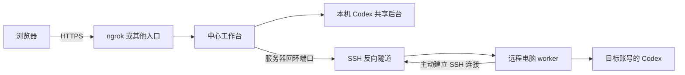

# Codex Remote Console

[English](README.en.md) · [部署指南](docs/DEPLOYMENT.md) · [多电脑接入](CONNECTOR.md) · [安全与数据](SECURITY.md)

自托管的 Codex 网页工作台：从电脑或手机查看项目和历史对话，在同一 thread ID 下继续会话，并通过 SSH 接入其他电脑。

本项目是独立的社区工具，与 OpenAI 无隶属关系。源码只提供通用方案和虚构测试数据；没有预置网站账号、机器注册、会话记录、接入密钥或公网域名。

## 功能

- 按电脑 → 项目目录 → 对话浏览，支持搜索、历史分页和归档查看。
- Markdown 标题、表格、列表、引用、任务列表与代码块；代码复制。
- 模型及推理强度选择，从下一条消息生效，默认保留原会话设置。
- JPG、PNG、WebP 图片选择、截图粘贴、拖入、预览与历史图片查看。
- 原生问题与选项回答；结束的旧询问折叠为历史。
- 单次权限审批、停止当前轮；不自动批准或恢复旧任务。
- 一条 SSE 连接推送变化，断网退避重连，页面隐藏时暂停连接；不定时发 HTTP 历史轮询。
- 多电脑独立接入密钥，SSH 反向隧道，图片及执行留在目标机器。
- 网站账号密码、scrypt 加盐哈希、HttpOnly/SameSite Cookie、CSRF 和来源校验。

## 快速开始：中心工作台

需要 Node.js 22+、npm、Git，以及已经安装并登录的 Codex。Linux 共享后台模式是主要验证环境；Windows worker 见下文。

```bash
git clone https://github.com/qihanchen-bishop/codex-remote-consol.git codex-remote-console
cd codex-remote-console
npm ci
cp .env.example .env
npm run setup -- --username your-account
npm start
```

密码在终端中隐藏输入，保存加盐哈希至私有状态目录。没有默认密码。打开 `http://127.0.0.1:8787`，用刚设置的网站账号登录；Codex 使用本机既有登录，无需在网页填写模型 API Key。

`npm start` 读取 `.env`。自动模式在 Linux/macOS 使用共享 daemon，没有 socket 时启动 daemon；Windows 使用独立 stdio app-server。进程启动、网页登录和历史读取不会调用 `thread/resume` 或开始一轮任务。

如果你的 Codex 必须通过代理包装器启动，在 `.env` 中配置：

```dotenv
CODEX_COMMAND_JSON='["/path/to/launcher","run","/path/to/codex"]'
```

参数按 JSON 数组处理，不作为 shell 代码执行。配置优先级和目录选项见 [.env.example](.env.example)。请使用原客户端相同的系统账号和 `CODEX_HOME`，才能发现被该 Codex 后台索引的本地历史。

## 内网与公网

内网访问可设置 `WEB_HOST=0.0.0.0`，重启后使用中心电脑的内网地址。公网推荐先用 **ngrok** 验证体验；它是可选反向代理，不是项目依赖。

1. 按 [ngrok 官方说明](https://ngrok.com/docs/getting-started/)安装并配置自己的账号。
2. 在 `.env` 中设置自己的 HTTPS 来源，例如 `WEB_PUBLIC_ORIGIN=https://your-domain.ngrok-free.app`，然后重启工作台。
3. 用你自己的 endpoint 启动隧道：

   ```bash
   ngrok http 8787 --url=https://your-domain.ngrok-free.app --inspect=false
   ```

`--inspect=false` 关闭 agent 的请求正文抓取。公网登录 Cookie 使用 Secure；来源必须与 `WEB_PUBLIC_ORIGIN` 完全一致。ngrok 会终止外部 TLS，需按自己的信任要求选用入口服务；本项目不配置或绕过 Codex 的模型出网代理。

Cloudflare Tunnel、Caddy/Nginx 或私有 VPN 也可接入。需要同一域名下多个网站时，可选用 `gateway.mjs`，将 `/codex/` 分给工作台；独立工作台不需要网关。完整配置见[部署指南](docs/DEPLOYMENT.md)。

## 接入另一台电脑



1. 在自己的网站侧栏点击“管理 / 添加”，注册一台 Windows 或 Linux 电脑。
2. 下载它的专用接入包，解压到目标电脑的私有目录。
3. 目标电脑安装 Node.js 22+、已登录的 Codex 和 OpenSSH 客户端。
4. Windows 运行 `powershell -NoProfile -ExecutionPolicy Bypass -File .\start-windows.ps1`；Linux 运行 `bash ./start-linux.sh`。
5. 按提示输入自己平时使用的 SSH 目标，保持窗口运行，再从网站选择这台电脑。

**运行时接入包含该电脑的密钥，不属于公开源码发布物。** GitHub 下载的源码本身不含 `connector.json`。详见[接入指南](CONNECTOR.md)。

## 会话交接与限制

- **看到历史与能续聊需分别验证。** 原生 API 读取被同一 `CODEX_HOME` 索引的历史；不自动聚合其他资料目录或云端专属会话。
- 已有会话沿原 thread ID 原生恢复，默认不覆盖模型和权限；只有明确选择才更新模型/推理强度。
- 执行中的会话、由其他任务管理的会话或原客户端仍独占的会话可能不能输入。先等待原轮完成，必要时由用户正常释放原客户端；不强制抢占。
- “接入实时会话”调用 `thread/resume`，不是只读操作。浏览历史和 SSE 同步不恢复会话。
- 原客户端持有的待审批请求可能仍需回原客户端处理，不把待审批当作网络故障。
- Windows 当前启动独立 stdio app-server，未实现复用桌面端共享后台。不要把协议握手成功视作当前桌面会话交接已经通过。
- Linux 共享 daemon 独立于网页进程；独立 stdio 进程的任务可能随接入进程退出而结束。
- 单用户、自托管、可信设备场景；不是多人权限隔离的托管服务。
- 同一网站进程中用消息 ID 去重；重启或超时后先核对历史，不保证跨进程恰好执行一次。
- 每条消息最多4张图片；原图20MB以内，处理后单张8MB以内、最长边2048像素。不渲染任意本地文件、LaTeX 或 Mermaid 消息图表。

## 配置、数据和发布

运行数据默认在 `.local/`，worker 数据在 `.connector-state/`。`.env`、账号哈希、机器密钥、图片、日志与会话数据均不提交 Git。登录会话保存在进程内存，工作台重启后需要重新登录。

```bash
npm run check
npm test
npm run privacy:check
```

隐私检查核对待提交文件名及常见密钥格式，不能替代人工审查。在首次提交前查看 `git diff --cached`。可选启用本仓库的提交钩子：`git config core.hooksPath .githooks`。

完成提交后，`npm run release:source` 审核并仅从 **Git HEAD** 导出公开源码 ZIP 和 SHA256；不会复制工作目录中的本地数据。不要发布“电脑管理”生成的私有接入包。

## 协议兼容性

基础实现验证过 Codex app-server 0.169.x；同版本范围不是永久兼容承诺。Codex 0.166.0 的 stdio 握手和只读列会话验证通过，真正 Windows 桌面端交接仍需在目标电脑验收。CI 使用模拟后台，不使用任何真实账号、会话或模型调用。

接口参考：[Codex App Server](https://developers.openai.com/codex/app-server)。升级 Codex 后，先用可丢弃会话分别验证历史、发送回执、模型回复和同一 ID 续聊。

MIT License。第三方依赖分别遵循自己的许可证，见 [THIRD_PARTY.md](THIRD_PARTY.md)。
